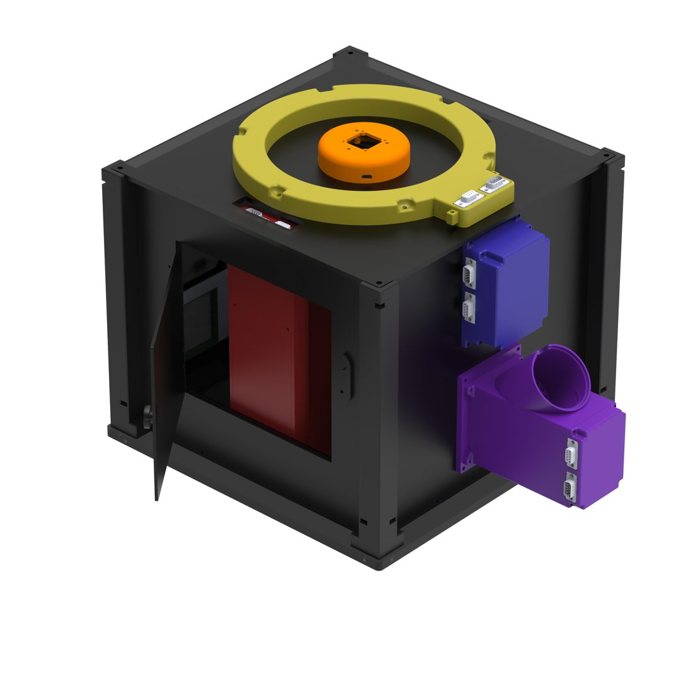

# Hardware

This section describes what the Open-BEATBox is made of: its **modules**, the **eight circuit boards** inside them, the **mechanical parts**, and how to get them made. The design files are in the [Open-BeatBox_Hardware](https://github.com/Open-BeatBox/Open-BeatBox_Hardware) repository (licence: CERN-OHL-S-2.0).



```{toctree}
:maxdepth: 2

modules
pcbs
mechanical
ordering-pcbs
flashing-cards
```

## The big picture

All electronics share one design philosophy:

- **One small computer per module.** Every board is built around an **RP2040** microcontroller, chosen because it is programmed by simply dragging a file onto a USB drive, supports Python and C/C++, and has many open-source libraries.
- **One shared network.** The modules are linked by the **CAN bus**, using the **MCP25625** CAN controller, a robust protocol that tolerates electrical noise ({doc}`CAN protocol <../software/firmware/can-intermodule-protocol>`).
- **One shared core circuit.** Each board reuses the same microcontroller and CAN circuit, with only the parts needed for its function added. That makes the system easy to customise or extend.

## Modules at a glance

| Module | Boards | CAN module ID | Role |
| --- | --- | --- | --- |
| {ref}`Main <module-main>` | `BB_RPI_shield_V1` | `0x1` | Link to the PC; power distribution; clock; memory card |
| {ref}`Feeder <module-feeder>` | `BB_feeder_main_V1`, `BB_feeder_IRBarrier_V1` | `0x2` | Delivers and detects pellets |
| {ref}`Nosepoke <module-nosepoke>` | `BB_nosepoke_V1` | `0x3` | Detects a nose poke |
| {ref}`Screens (×2) <module-screen>` | `BB_screen_main_V1` ×2, `BB_IR_light_curtain_V2_38k` | `0x4` left, `0x5` right | Shows a pattern, detects a response |
| {ref}`Lighting <module-lighting>` | `BB_lighting_V1` | `0x6` | White, red and infrared lighting |
| {ref}`Tunnel / photobeam gate <module-tunnel>` | `BB_tunnel_V1`, `BB_IR_light_curtain_V2_38k` ×2 | `0x7` | Detects entering and leaving, and direction |

## Before module assembly

Boards must be flashed **before** they are installed in a module. Start with {doc}`flashing-cards`.

## Hardware generations

Two mechanical generations are published (**V2** and **V3**); the electronics in the repository are the V3 modules. See {doc}`mechanical`.

## Where to go next

- Which board is which, what is on it, and how many do I need? → {doc}`pcbs`
- How do I order the boards? → {doc}`ordering-pcbs`
- Which file do I print or cut? → {doc}`mechanical`
- How do I build a module? → {doc}`../build/assembly`
