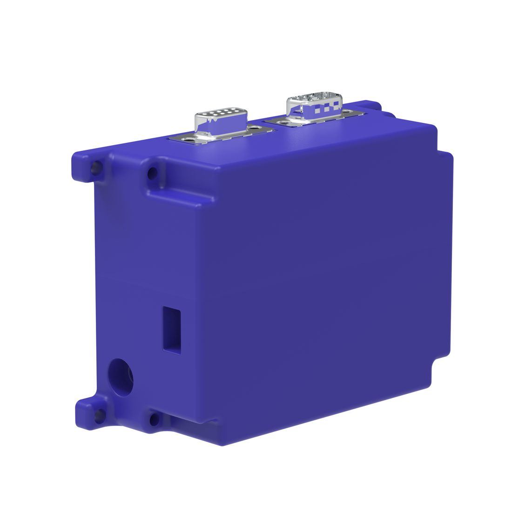
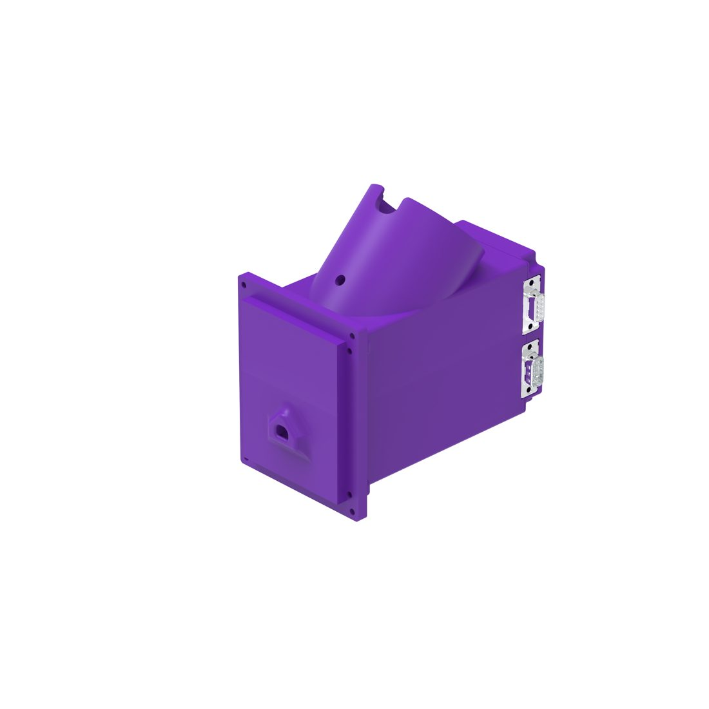
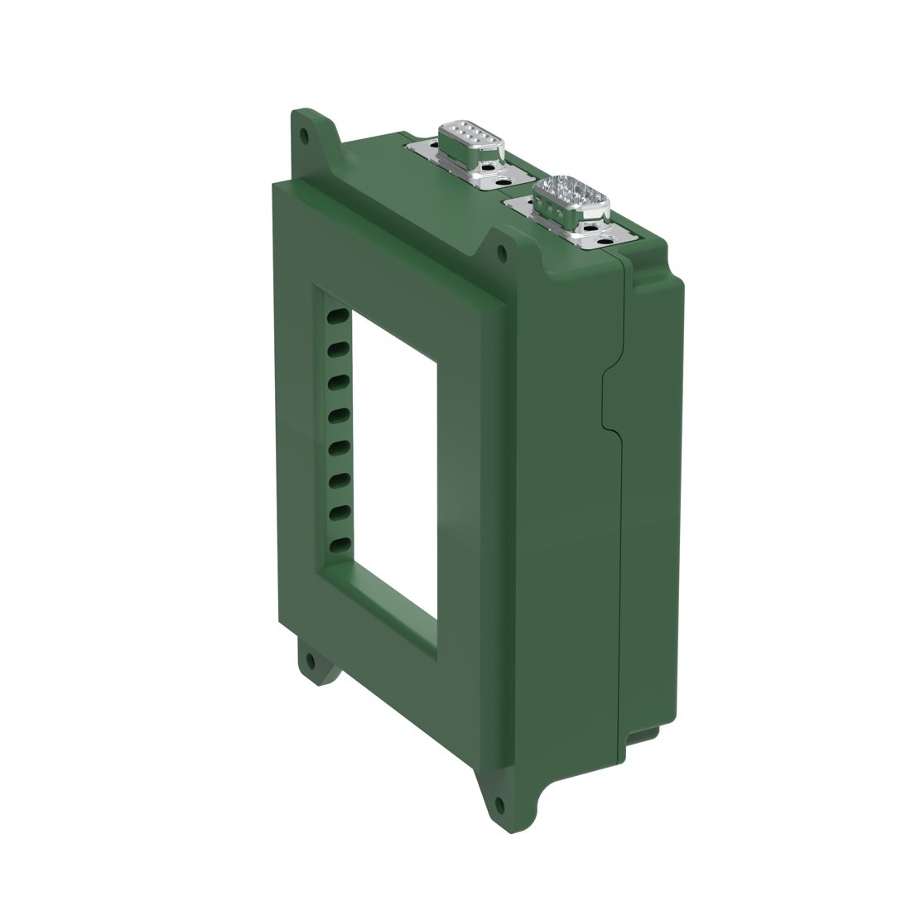
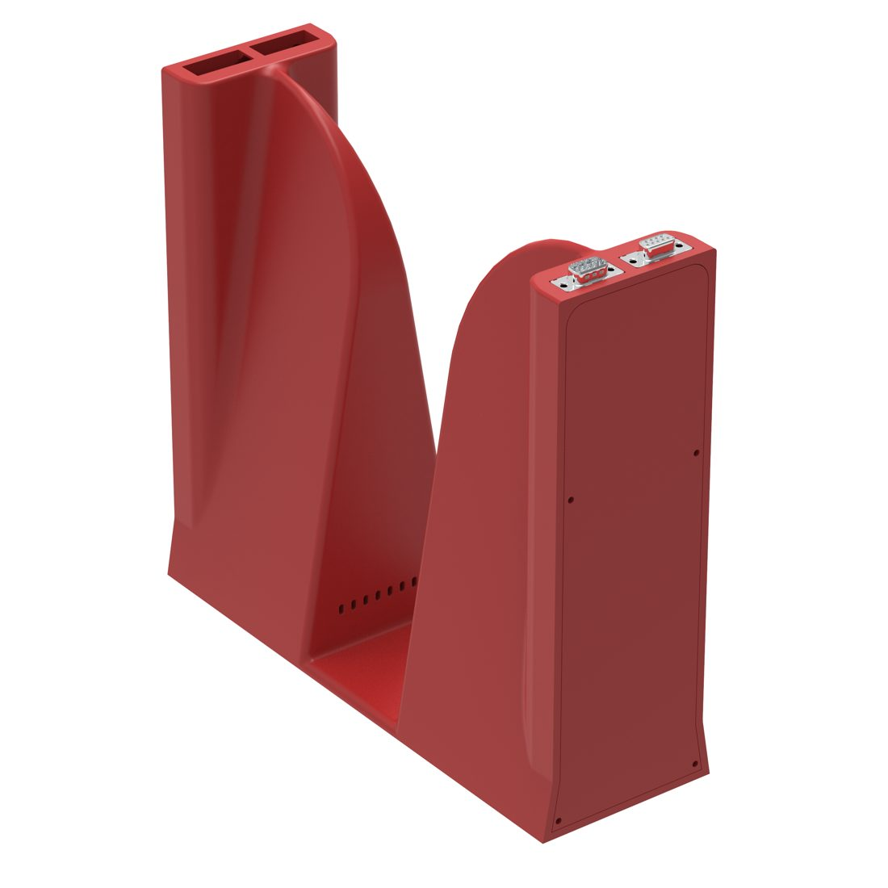
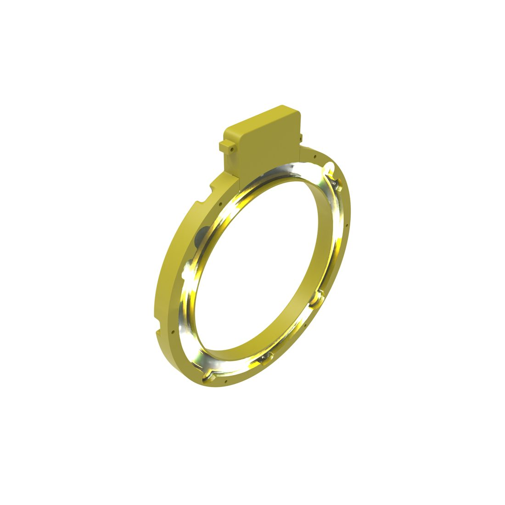

# Modules

Open-BEATBox is built from independent modules. Each module has its own housing, its own circuit board(s) and its own microcontroller, and is linked to the others by the CAN bus (and by power cables). This page describes each one: **what it does, what is inside, which files make it, and which firmware runs on it**.

```{note}
The *CAN module ID* is the address the module answers to on the bus. It is the same number you will see in the firmware and in the {doc}`CAN protocol <../software/firmware/can-intermodule-protocol>`. The module-to-board mapping below follows the Hardware repository and the assembly tutorials; points still to confirm with the designers are listed in {doc}`../project/status`.
```

(module-main)=
## Main module



| | |
| --- | --- |
| **Role** | The switchboard between your PC and the other modules. It does not run the experiment. |
| **Board** | `BB_RPI_shield_V1` (×1) |
| **CAN module ID** | `0x1` (`MAIN`) |
| **What is on it** | RP2040 microcontroller, CAN controller, connection to the computer, distribution of **5 V and 12 V** to the other boards, **real-time clock** (RTC), **microSD** slot |
| **Mechanical files** | `mechanical/V3/main/` (`RPI_shield_base_V3.STL`, `RPI_shield_top_V3.STL`) |
| **Firmware** | `micropython/modules/main_module/main_module.py` |
| **Link to the PC** | UART0 (pins GP0 = TX, GP1 = RX) at **921600 baud**, typically through a USB-serial adapter |

The board is designed as a shield (add-on board) for a single-board computer connector. In the current firmware, the main module is not a Raspberry Pi: it is an RP2040 board that forwards messages. See the open points in {doc}`../project/status`.

(module-feeder)=
## Feeder



| | |
| --- | --- |
| **Role** | Delivers one food pellet on request and detects that it arrived and was taken. |
| **Boards** | `BB_feeder_main_V1` (×1) with an **A4988** stepper driver, and `BB_feeder_IRBarrier_V1` (×1) with an infrared photo-interrupter (**GP1A57HRJ00F**) |
| **Also needed** | Stepper motor **14HM11-0404S** (0.9° per step) |
| **CAN module ID** | `0x2` (`FEEDER`) |
| **Mechanical files** | `mechanical/V3/feeder/` (base, cover, front, front bottle guide) |
| **Firmware** | `micropython/modules/feeder.py` |

**Two ways to deliver a reward.**

1. *Direct control (used by the PC application today).* The PC switches the motor on, watches the pellet sensor, and switches the motor off. The PC owns the timing and the retries. As a safety, the feeder stops the motor by itself after 15 s.
2. *Autonomous (used by the `FEED` test command).* One request is enough. The feeder turns its disc by a small fraction of a turn, waits up to 0.5 s for its infrared sensor to see the pellet, and tries again, up to 20 times (one full turn). It reports how many attempts it needed. If all 20 fail, it reports an error and stays in an error state until the next successful reward. A rising number of attempts means the feeder is running low or beginning to jam — a useful health indicator.

In both cases the sensor reports *pellet present* when a pellet arrives and *pellet taken* when it is removed.

(module-nosepoke)=
## Nosepoke

| | |
| --- | --- |
| **Role** | Registers a nose poke by an infrared beam break. |
| **Board** | `BB_nosepoke_V1` (×1), infrared photo-interrupter **GP1A57HRJ00F** |
| **CAN module ID** | `0x3` (`NOSEPOKE`) |
| **Firmware** | `micropython/modules/nosepoke.py` |

The nosepoke board and firmware are published, but the standard V3 assembly tutorials do not include a nosepoke module; the current training stages detect pellet collection at the feeder. Use the nosepoke module to build your own tasks.

(module-screen)=
## Screens (left and right)



| | |
| --- | --- |
| **Role** | Shows a visual pattern and detects the animal's response. There are two, one on each side. |
| **Boards** | `BB_screen_main_V1` (×2, one per screen) and `BB_IR_light_curtain_V2_38k` (two per screen) |
| **Also needed** | **2.8″ TFT colour screen with touch breakout** (ILI9341, Adafruit 1770) ×2, driven over an 8-bit parallel bus; the board also controls the backlight |
| **CAN module IDs** | `0x4` (`SCREEN_LEFT`), `0x5` (`SCREEN_RIGHT`) |
| **Mechanical files** | `mechanical/V3/screen/` (base, cover) and screen walls in `mechanical/V3/enclosure/` |
| **Firmware** | `micropython/modules/screenmodule.py` (one program for both; the side is set by one line in the file, see {doc}`flashing-cards`) |

The **infrared light curtain** boards emit 38 kHz pulsed infrared beams, which makes them insensitive to ambient light, and give a single combined "beam interrupted" output used to detect a response. The firmware reports a response as a *touch event*. The screen shows a pattern chosen by a number (white, black, horizontal lines, vertical lines, grid, diagonals — see {doc}`../software/configuration`).

(module-tunnel)=
## Photobeam gate (tunnel)



| | |
| --- | --- |
| **Role** | Detects that the animal enters the task area, and the direction and speed of its movement. |
| **Boards** | `BB_tunnel_V1` (×1, the controller) and `BB_IR_light_curtain_V2_38k` (×2, one on each side) |
| **CAN module ID** | `0x7` (`IR_BARRIER`) |
| **Mechanical files** | `mechanical/V3/tunnel/` (tunnel base, lateral cap) |
| **Firmware** | `micropython/modules/ir_barrier.py` |

The controller reads each beam, applies a debounce of 10 ms to ignore flicker, and reports beam-break events. It carries a **Qwiic** connector (a standard I²C connector used by Adafruit and SparkFun add-ons), and its unused microcontroller pins are accessible for future expansion.

(module-lighting)=
## Lighting



| | |
| --- | --- |
| **Role** | Day / night cycle and illumination for video: white, red and infrared. |
| **Board** | `BB_lighting_V1` (×1), LED driver **PCA9955B** |
| **LEDs** | 5000 K white, 615 nm red, 940 nm infrared |
| **CAN module ID** | `0x6` (`LIGHTING`) |
| **Mechanical files** | `mechanical/V3/lighting/` (base, cap, cover) |
| **Firmware** | `micropython/modules/lighting.py` |

The three colour groups can be switched on and off, and their brightness (duty cycle, 0–255) set, independently.

## Frame, enclosure and water bottle mount

The frame, walls, door and base plate are laser-cut and 3D-printed; they are described in {doc}`mechanical` and built with the first tutorial ({doc}`../build/assembly-tutorials/modules/mod-frm-assembly`). A separate tutorial builds the water bottle mount ({doc}`../build/assembly-tutorials/modules/mod-bmt-assembly`).

## Camera

A small colour camera (listed under additional components in {doc}`pcbs`) can be installed for video. The V2 mechanical files include a camera and NeoPixel-ring support. No firmware or CAN interface for the camera is documented; it is recorded separately from the experiment data.

## Cabling

- Inside modules, boards are connected with Molex **PicoBlade** cables (3-position and 6-position, depending on the board).
- Between modules, the housings carry **DB9** connectors, and DB9 cables are used.
- Power comes from a **12 V** adapter into the main module, which distributes 5 V and 12 V.
- The PC connects to the main module only.
