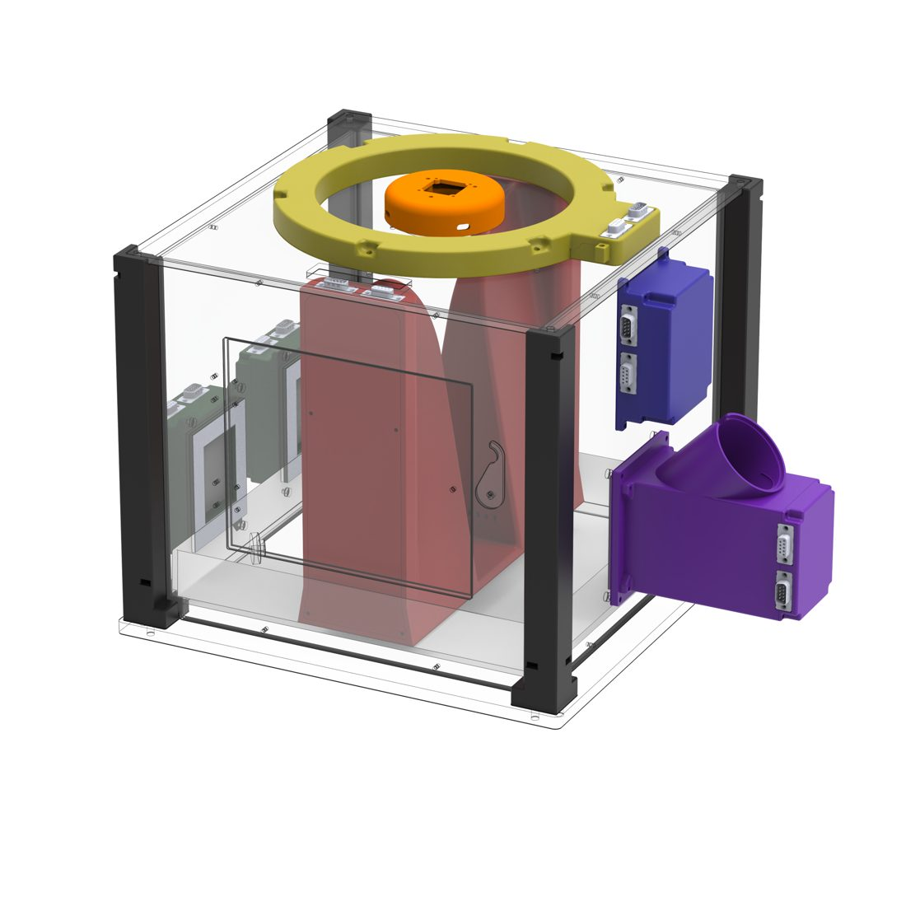

# Open-BEATBox User Manual

**Open-BEATBox** (*Open — BEhavioural and AuTonomous operant Box*) is an open-source, modular, low-cost box that lets mice take part in behavioural tasks **inside their own home cage**, day and night, with no experimenter in the room. The box delivers food rewards, shows images on two screens, senses what the animal does, and writes everything to files on your computer.

This manual explains how to **build** one, how the **electronics, firmware and software work together**, and how to **run experiments** with it. It is written so that you can follow it without being a programmer: every technical term is explained the first time it appears, and there is a {doc}`glossary` for the rest.



## Where do you want to start?

::::{grid} 1 1 2 3
:gutter: 3

:::{grid-item-card} 🧭 I am new here
Understand what the box is, what it is made of, and how a single trial flows from the animal to your data file.

{doc}`overview` · {doc}`how-it-works`
:::

:::{grid-item-card} 🛠️ I want to build one
Bill of materials, fabrication, module-by-module assembly tutorials, flashing the boards, and a first power-up check.

{doc}`build/index`
:::

:::{grid-item-card} 🐭 I want to run experiments
Install the control application, choose a training stage, start a session and read the result files.

{doc}`software/pc-app`
:::

:::{grid-item-card} 🔌 I want the hardware details
Modules, the eight circuit boards, mechanical files, and how to order the boards.

{doc}`hardware/index`
:::

:::{grid-item-card} 💾 I want the firmware and protocol
How the modules talk to each other over the CAN bus, how to flash and deploy the firmware, and the test command-line tool.

{doc}`software/firmware/index`
:::

:::{grid-item-card} 🤝 I want to contribute
Which repository takes what, how the manual is built, and the open points where help is needed.

{doc}`contributing` · {doc}`project/status`
:::

::::

## The whole project on one page

Open-BEATBox is published as separate repositories, one per "layer", each under the licence that fits it. This manual is the single place that ties them together.

| Layer | What you will find there | Repository |
| --- | --- | --- |
| **Hardware** | CAD, enclosure, KiCad circuit boards, manufacturing files | [Open-BeatBox_Hardware](https://github.com/Open-BeatBox/Open-BeatBox_Hardware) |
| **Software** | PC control application, module firmware (MicroPython), validation command-line tool | [Open-BeatBox_Software](https://github.com/Open-BeatBox/Open-BeatBox_Software) |
| **Firmware** | Reserved repository for stand-alone firmware releases (no source yet — see {doc}`software/firmware/index`) | [Open-BeatBox_Firmware](https://github.com/Open-BeatBox/Open-BeatBox_Firmware) |
| **Build guides** | Per-module assembly tutorials and the Master bill of materials | [Open-BeatBox_Documentation](https://github.com/Open-BeatBox/Open-BeatBox_Documentation/tree/main/source/build/assembly-tutorials) |
| **Documentation** | This manual and its media | [Open-BeatBox_Documentation](https://github.com/Open-BeatBox/Open-BeatBox_Documentation) |
| **Website** | The public site and the build pipeline that publishes this manual | [Open-BeatBox.github.io](https://github.com/Open-BeatBox/Open-BeatBox.github.io) |

See {doc}`project/repositories` for licences and how the pieces are versioned together, and for **how to cite** Open-BEATBox (the preprint and the Zenodo record of the release you used).

```{admonition} Project status
:class: note
Open-BEATBox is a **working platform under active development**. The hardware has been built several times and the assembly tutorials are in use, but the software is a development version: interfaces may still change, and some validation work is not finished. {doc}`project/status` lists exactly what is stable and what is not.
```

```{toctree}
:maxdepth: 2
:caption: Understand
:hidden:

overview
how-it-works
getting-started
glossary
```

```{toctree}
:maxdepth: 2
:caption: Build
:hidden:

build/index
hardware/index
```

```{toctree}
:maxdepth: 2
:caption: Run and develop
:hidden:

software/index
protocols/index
```

```{toctree}
:maxdepth: 2
:caption: Help and project
:hidden:

troubleshooting
project/index
contributing
```

## Frequently used pages

- {doc}`Modular assembly tutorials <build/assembly-tutorials/tutorials_index>`
- {doc}`Master BOM (CSV and XLSX) <build/bom>`
- {doc}`Flashing the module boards <hardware/flashing-cards>`
- {doc}`First power-up and test <build/first-power-up>`
- {doc}`Training stages S1–S4 <software/stages>`
- {doc}`Troubleshooting <troubleshooting>`
- <a href="../../">Project website</a>
