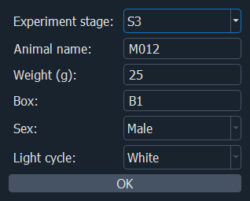
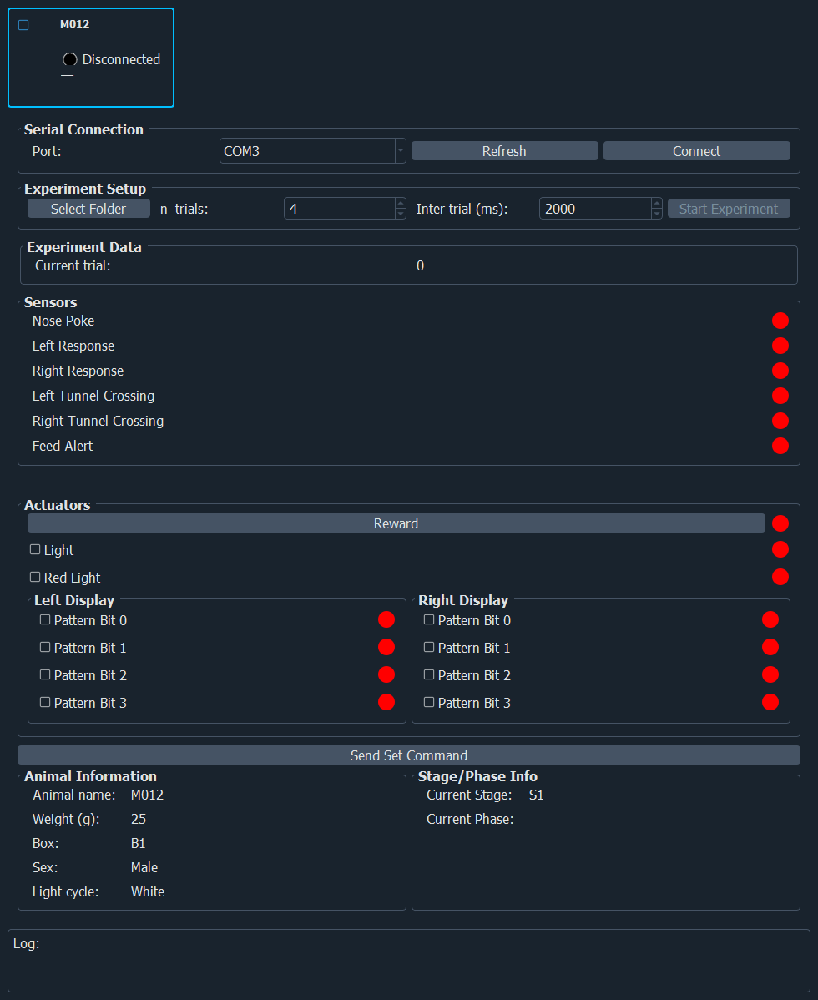
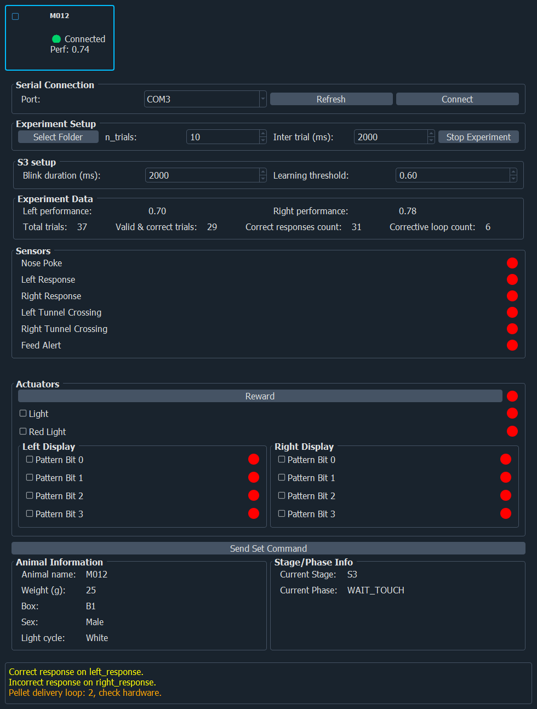
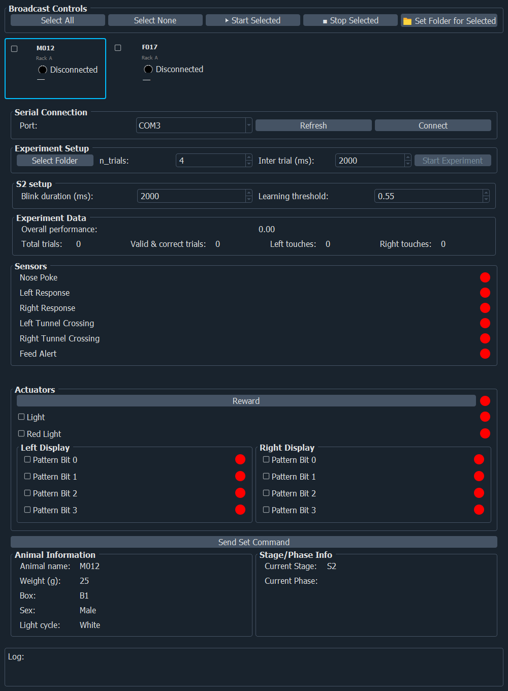

# Using the PC application

This page walks through a session with the control application, from launch to the result files. It assumes the application is installed ({doc}`install`) and the box is powered and connected, with the main module in **experiment (V2 emulation) mode** ({doc}`firmware/deploy`).

```{admonition} About the screenshots
:class: note
The screenshots on this page were taken with a **simulated box** (no hardware connected), so the sensor indicators are all off and the numbers in the stage panel were filled in for illustration. They show the real layout of the current interface.
```

## Your session in six steps

1. **Launch** the application (`beatbox`).
2. **Choose the stage and enter the animal's details** in the first dialog.
3. **Connect** to the box: choose the serial port, click *Connect*.
4. **Choose the experiment folder** where results will be saved.
5. **Start** the experiment.
6. **Monitor**; **stop** when done (or let the stage finish).

## 1–2. The start dialog

On launch, a small dialog **Select Experiment Stage** appears.



| Field | What to enter |
| --- | --- |
| **Experiment stage** | `S1`, `S2`, `S3`, `S3.1`, `S4`, or **All** |
| **Animal name** | The animal's identifier. It is written in the file names and in the logs. |
| **Weight (g)** | The animal's weight |
| **Box** | The box identifier |
| **Sex** | X (unset), Male or Female |
| **Light cycle** | X (unset), Red or White |

- Choose a single stage to run just that stage.
- Choose **All** to start at **S1**; when a stage is complete, the application **moves automatically to the next one** (S1 → S2 → S3 → S3.1 → S4) and shows *Experiment complete* after S4. See {doc}`stages` for what each stage is.

Use identifiers that are unique and consistent across animals and boxes: they end up in your data.

## 3. Connect to the box

The main window has one **panel per box** (one by default; several if you started with `--n-devices`). Before you connect, it looks like this (stage S1):



In a panel:

- **Serial Connection**: pick the **Port** (click *Refresh* if the list is empty) and click **Connect**. A progress window appears while the application performs a **handshake** with the main module. When it succeeds, the card's status turns to connected.
- If the handshake fails, check that the main module is in experiment mode and that no other program is using the port ({doc}`../troubleshooting`).

## 4. Choose the experiment folder

Click **Select Folder** (in *Experiment Setup*) and pick or create a folder for this session. **The *Start Experiment* button stays disabled until you are connected *and* have chosen a folder.** This is where the CSV files are written ({doc}`data-output`).

## 5. Start the experiment

Click **Start Experiment**. The button turns into **Stop Experiment**. The experiment runs as a sequence of **phases** shown under *Current Phase*, for example *ITI*, *WAIT_TUNNEL*, *SHOW_STIM*, *WAIT_TOUCH*, *DELIVER_PELLET*, *WAIT_PELLET_RETRIEVAL*.

In the *Experiment Setup* area you can see (and change before the start) the number of trials and the inter-trial interval. Stages from S2 have a **stage setup** area with the **blink duration** (how long the screens flash after an error) and the **learning threshold**.

## 6. Monitor

This is a stage S3 panel during a session (simulated values): connected card at the top, left and right performance, trial counters, sensors, actuators, animal information, phase and the log.



Each box panel shows:

| Area | What it tells you |
| --- | --- |
| **Summary card** (top row) | Box name, connection status, current stage and phase, at a glance. Handy with several boxes. |
| **Stage setup / Experiment Data** | Trial counters and success rates for the stage: current trial (S1); total trials, correct responses, left and right touches and overall performance (S2); left and right performance, correct count and number of corrective loops (S3, S4). |
| **Sensors** | One indicator per sensor: nose-poke / pellet sensor, left and right response, left and right tunnel crossing, feeder alert. They light when the sensor is active. |
| **Actuators** | Reward, lights, and the **left and right display** controls. You can switch them by hand to test (for example *Send Set Command*). Avoid doing this during a real session. |
| **Pellet alert** (red text) | Appears if the application has had to retry pellet delivery several times: *check the feeder*. |
| **Animal Information** | The details you entered. |
| **Stage / Phase info** | Where the experiment is in the stage. |
| **Log** (bottom) | A running log, coloured by level (yellow information, orange warning, red error). |

### Several boxes at once

With `--n-devices 2` (or more), one panel per box is shown, named *Box 1*, *Box 2*, …. The **Broadcast Controls** let you tick several boxes (**Select All** / **Select None**) and then **Start Selected**, **Stop Selected** or **Set Folder for Selected** in one click.



## Stopping

Click **Stop Experiment**. The application stops the trial sequence, resets the outputs to a known state, logs *Experiment ended*, and closes the event log. Closing the window closes the serial connection.

## What a stage looks like to you

- The application waits for the animal, runs the trials, and updates the counters.
- When the success rate reaches the **learning threshold** (see {doc}`stages`), the stage ends and — if you chose **All** — the next one starts.
- Every sensor change and every trial is recorded in the CSV files as it happens, and flushed to disk immediately, so a crash does not lose what was recorded before it.

## Good practice

- Do a short dry run **without an animal** after any change to the box or the software.
- Keep a copy of the configuration file used for each cohort ({doc}`configuration`).
- Record the software version and firmware version with your data.
- Copy the CSV files to a safe location after each session and never edit the originals.
